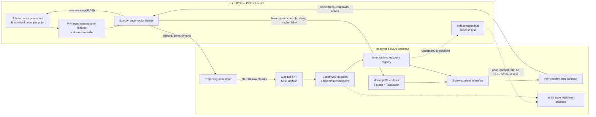

# RoboRender: distributed BC and real-time DAgger

Canonical online source: [ldu-nvidia/roborender-for-real-time-Dagger](https://github.com/ldu-nvidia/roborender-for-real-time-Dagger).
The RTX and Cosmos checkouts share one history on `main`; see the
[version-control and release procedure](docs/VERSION_CONTROL.md).

This repository contains one source tree for the RoboRender project. It covers
teacher demonstration collection, offline photorealistic rendering, behavioral
cloning (BC), distributed online DAgger, and closed-loop success evaluation.

The live DAgger system is split across two machines:

- RTX PRO 6000 actor processes own Isaac, the privileged teacher, and the only call to
  `env.step`; and
- explicitly reserved H200 workers own Image3F, student inference and learning;
  CPU access services own orchestration, checkpoint registration and ledgers.

Use a reviewed Git commit or an explicitly pinned source-only release on both
machines; matching Git HEAD alone does not attest uncommitted/runtime code.
Host-local datasets, checkpoints,
renderer weights/engines, secrets, logs, and runtime journals are deliberately
outside Git and are bound by SHA-256 manifests.

**H200 retention policy (October15 user override):** once secured, keep the
RoboRender allocation until the user explicitly requests its release. Finishing
or stopping a workload is not permission to delete or scale down the allocation.
Record retained capacity; do not fabricate GPU activity to avoid reclamation.
Historical smoke release receipts below describe the previous policy.

## Agent and collaborator onboarding

All first-party test code lives under `test/`, separate from production modules;
see the [test layout](test/README.md)
and [source cleanup audit](docs/CODE_CLEANUP_20261025.md). The compact
[pipeline source map](pipeline/README.md) identifies current stage entrypoints;
the dated deployment history below does not override the production contract.

Storage/source reorganization: see [the host/disk layout and migration boundaries](docs/STORAGE_LAYOUT.md)
and [central path registry](configs/storage_paths.json). Existing frozen runs keep
their original physical paths; new catalogs do not relabel historical evidence.

Read the [end-to-end pipeline contract](docs/END_TO_END_PIPELINE_CONTRACT.md)
first. It contains the pre-BC, BC and DAgger pseudocode, model/data locations,
GPU ownership, checkpoint and validation rules, and the remaining beta gates.
It separates the tested deployment from historical settings and production
targets; a future agent should not need the chat history to recover them.

## Current operator entrypoint — October 18

**October25 DAgger correction:** the new continuous-round schema removes the
two-window forced scene reset. Each RTX keeps one physical scene through100
81-step updates; only natural terminal conditions reset lanes. Raven's model
rollout buffers still reset every81 steps. Fixed lane-to-motion assignments
mean32 training motions, not295-motion rotation. See the
[source comparison and limits](pipeline/RAVEN_EQUIVALENCE_AUDIT.md) and
[current contract](docs/END_TO_END_PIPELINE_CONTRACT.md). Native activation is
still gated; CPU tests do not certify a live round.

**Latest October24 scaling request:** the B2 BC116 evaluation was stopped by
the user. Build and qualify B16 on each Leo RTX with eight independent H200
renderers on one reserved full node; retain all other compute. This explicitly
supersedes finish295-first below. The scaled295 panel preserves motion support,
not B2 reset realizations; old scores are not reused. Current-source native
qualification remains required before a production-readiness claim. Read the
[current contract](docs/END_TO_END_PIPELINE_CONTRACT.md) for exact gates.

**Latest October24 protocol:** no native ray-traced RGB may feed the student
in new training or success tests. BC uses offline teacher50 renders; DAgger and
success testing use genuine online Image3F5 head/left/right images. New DAgger
rounds use teacher75/50/25/0%, exactly100 accepted full B32×81 updates each,
no held-out collection/MSE validation/patience, and update100 for testing and
weights+AdamW handoff. The later explicit stop/scaled295 request above supersedes
the earlier finish-B2-first sequence. Activate only a freshly admitted source/run;
never release Cosmos compute as cleanup. All-rendered capacity admission remains
required. Historical frozen runs retain their original protocols.

New BC/DAgger student success evaluations require generated images, including smoke.
The fixed295 cases/seeds/reset/scoring stay unchanged under a new rendered
panel/protocol identity; missing rendering fails closed. Historical ray-traced
scores and frozen live releases are not relabeled. See the
[current contract](docs/END_TO_END_PIPELINE_CONTRACT.md).

Use [RUN_MODES.md](pipeline/deployment/RUN_MODES.md): `--mode smoke` or
`--mode production`, with immutable settings and a fresh output namespace.
The command stages only unless `--execute --execution-settings FILE` is supplied.
Never change a running campaign's mode or interpret staging as a successful test.

The [October 18 smoke](docs/SMOKE_VALIDATION_20261018.md) completed fresh BC
preparation, BC optimization, all four mixed-policy rounds, held-out MSE selection,
corrected success testing, and online W&B readback. Its small budgets certify
execution, not policy quality. Production BC subsequently completed on
2,560 training and320 validation chunks: best epoch51 validation MSE0.252505;
the selected checkpoint scored64/295 in the corrected native success test.

Paired RTX probes at16/32/64 environments passed their bounded native workload.
The current full-batch H200 learner limits the joint production configuration to
16 environments per RTX (32 total) with four H200 workers; RTX capacity alone is
not end-to-end qualification. Production DAgger recovery passed the bounded
joint gate described below; it is not a completed four-round production run.
See [ledger durability and recovery](docs/LEDGER_DURABILITY.md); use actual
controller/receipt evidence for current progress. Frozen native releases remain
unchanged by explicitly recorded control-only reader fixes.

The earlier v13 recovery completed320 independent held-out chunks and three real
optimizer updates, but its fourth update encountered a native Isaac camera
graph-evaluation stall. This is **not** a completed production qualification.
See [the bounded progress guard and incident](docs/NATIVE_CAPTURE_STALL_20261018.md).
Fresh, warm-scene and recorded-action native diagnostics subsequently passed;
the last reproduced all129 available reference state/teacher batches exactly
and completed beyond the failed capture. They did **not** reproduce the stall
or establish a cure. Its entire failed first round was excluded from a separately
admitted fresh restart; completed BC/test receipts and the four H200s were retained.

**October 19 update:** v14 later stopped during iteration13 after a sustained
memory-pressure watchdog trip (not OOM); twelve updates are preserved and the
partial iteration cannot be replayed. Four H200s remain allocated. The earlier
fresh v14 restart passed the actual two-cohort joint
qualification: 32 environments total, four full32×81 optimizer updates, 10,368
training transitions, preserved AdamW/checkpoint lineage, and online W&B readback.
Both native owners stayed warm; no OOM or swap was recorded. This admits the
bounded production configuration, not all four completed production rounds or
a cure for the earlier native stall. See
[the measured qualification and remaining gates](docs/PRODUCTION_QUALIFICATION_20261019.md).

The dated sections below are historical evidence, not current launch defaults.

## October 15 reuse-first BC production protocol

The user selected reuse of all **2,000 historical raw chunks for training**,
plus **320 fresh MSE-validation chunks** and an independent **295-case native
success test**. Original data/splits remain unchanged. Missing historical
motion/reset metadata stays unknown; this is not the separately planned
all-fresh matched-population certificate. Independent rendering and new native
validation require their actual execution receipts before training.
See [the approved reuse protocol](docs/BC_LEGACY_REUSE_20261015.md).

## Current status — October 15 MSE-selected end-to-end smoke completed

Fresh native BC collection, genuine independent three-view rendering, full-B16
BC optimization/resume, and four mixed-policy DAgger rounds have now completed
with **held-out MSE selection and a separate actual success test after each
round**. The latest online test used two environments per Leo actor, four H200
workers, one full4×81 update per round, and two success-test cases. All four
held-out losses decreased; all four success results were0/2. These deliberately
small smoke budgets establish execution, not policy quality or convergence.

Read [the new qualification and remaining production gates](pipeline/deployment/QUALIFICATION_20261015_MSE.md).
The successor data plan is2,560train+320validation chunks across295motions,
plus a separately seeded295-case closed-loop test. The first9selected chunks
are collected and transferred, not a complete production dataset. Actual
single-collector B1/B6 full-buffer qualification and all40geometry checks passed;
remaining collection/rendering and full-motion DAgger cohort continuity are
still production gates. Leo's approximately
62GiB host RAM—not its96GiB-per-GPU VRAM—is the principal collection limit.

## Earlier deployment evidence — completed Leo warm smoke

**October 15 research-protocol audit:** the completed smoke below remains valid
infrastructure evidence, not certification that the historical BC data matches
Raven's three-view experiment. The supplied three-view rendering launcher uses
independent clips (`max_chain=1`); the historical six-clip pool also contains
render-reference dependencies crossing its old splits. New production must use
the versioned independent recipe and metadata admission. The requested
validation-MSE stopping rule is an explicit extension to Raven, separate from
the final closed-loop success test. Capacity and native data-provenance
qualification are in progress; no updated full-population production run is yet admitted.
See the [dated contract override](docs/END_TO_END_PIPELINE_CONTRACT.md#october-15-raven-fidelity-and-statistical-protocol-override).

The dedicated **`leo-rtx-6k` (physical GPUs 0 and 1)** and four reserved H200s
completed all four DAgger smoke rounds on October 14, 2026 (Pacific). Each round
ran three full 12×81 updates and a ten-case closed-loop success panel. Across
the campaign: **12 updates, 144 chunks, 11,664 committed transitions**, verified
online W&B metrics, and one native initialization per RTX worker. The previously
completed BC smoke was reused with provenance; BC was not trained again.

See [the completed qualification](pipeline/deployment/QUALIFICATION_20261015.md)
for results, source identities, recovery evidence and limitations. This validates
the bounded infrastructure flow; production-length operation and policy quality
remain separate checks. All H200 allocations were released after GPU work.

## Historical Beta deployment status — 2026-10-12

**Leo migration, October 13:** assets/container are copied and verified on the
dedicated `leo-rtx-6k`. The [Leo runbook](pipeline/deployment/LEO_MIGRATION.md)
defines GPUs 0+1 and a Leo-owned Cosmos route. The completed Leo qualification
is linked above; Beta's historical results below are separate evidence.

Start with [the deployment runbook](pipeline/deployment/WORKING_REPO.md), not
the historical alpha launcher. The selected beta reference profile is
[2 RTX / 4 H200](pipeline/deployment/profiles/beta_2rtx_4h200.v1.json):

- beta physical GPUs **1 and 2**, six environments each; GPU0 is excluded;
- four genuine Image3F/student workers on reserved `custom.gpu.4xh200`;
- three persistent concurrent 81-step windows, 2,916 transitions and three
  real full 12×81 optimizer updates passed, including deliberate lost-ack recovery;
- warm collection around 194–199 s/window and learner jobs 16–22 s;
  one-time concurrent Isaac startup was 495 s;
- actual MSE/global-step metrics verified in cloud W&B, no container OOM/swap;
- full paired 256-case success evaluation completed: BC 0/256 (0%), the
  three-update candidate 11/256 (4.30%); all 52 cohort starts matched;
- corrected BC epoch-41 resume, fresh teacher-only collection, and a fresh
  three-view 50-step offline render have also passed functional tests.

This is bounded **v3 / Isaac 6** runtime and success-accounting qualification,
not a policy-quality or production endorsement. The legacy alpha
**v4 / B28 / eight-H200** path remains explicitly separate. The new
[beta round automation](pipeline/deployment/BETA_ROUND_AUTOMATION.md) implements
four B12/current-iteration-only rounds with 50 updates and final success
validation each; its deployment handoff still requires native qualification.
Simulator-distribution comparison remains a distinct gate. See
[the dated qualification report](pipeline/deployment/QUALIFICATION_20261012.md).
No benchmark candidate is promoted.

Planning is CPU-only and does not allocate or launch anything:

```bash
python3 pipeline/deployment/plan.py --stage qualification
python3 pipeline/deployment/plan.py --stage bc
```

## End-to-end system



### One vector step

For every rollout index, all `B` environments within one RTX actor move
together (`B=2` in the latest MSE smoke; `B=6` in the earlier profile). Both actors contribute to the learner
barrier; one actor cannot trigger an update with the other's rows missing.

1. RTX captures the current three-view Isaac controls and actor/critic state.
2. The privileged teacher produces the 11 manipulation dimensions; Homie
   supplies the deterministic 15-dimensional locomotion tail. The 26-D teacher
   action is retained for every visited state; only its first 11 dimensions
   enter the student action MSE.
3. RTX shards a lean payload across the configured independent H200 gateways
   (four v3 gateways in the beta reference profile).
4. H200 renders three current RGB views with Image3F using the episode's fixed
   anchor. Every new training episode is generated-only; native RGB never
   bypasses the renderer into the student.
5. H200 runs the frozen student on the current three-view observation. A
   persisted Bernoulli draw selects teacher or student behavior according to
   the round beta.
6. Only after all `B` selections return does that actor execute exactly one
   `env.step([B,26])`.
7. Outcomes are committed to H200. In the legacy v4 path, the previous-step commit is pipelined
   with the next-step prepare; full learner rows remain in H200's per-window
   cache instead of being copied back to RTX.

The prepare/commit protocol is idempotent. A partial prepare cannot step Isaac,
and a lost acknowledgement cannot cause a second physical environment step.

### One learning iteration

One iteration is **not one episode**. It is an 81-row rollout window for each
of every lane:

```text
81 sequential steps × 2 actors × B environments = 162B supervised transitions
                                               = 2B learner chunks
                                         = 1 full (2B)×81 optimizer update
```

A window may cross a real episode boundary. Per-row episode IDs, episode step
indices, `done`, and `timeout` preserve that fact. The current Raven-faithful
protocol trains on the current window only, with no previous-window/round or
BC replay. Legacy replay utilities remain historical and must not silently
change this scientific contract. The latest B2+B2 smoke produces324transitions
and4chunks per update; the older B6+B6 profile produced972and12.

### Four DAgger rounds

The teacher labels every state in every round. The beta changes only which
action moves Isaac:

| Round | Teacher behavior | Student behavior |
|---:|---:|---:|
| 1 | 75% | 25% |
| 2 | 50% | 50% |
| 3 | 25% | 75% |
| 4 | 0% | 100% |

Observation source is independent of the behavior mixture: every new episode
uses Image3F. Each round has100 accepted updates. Round1 starts from BC116;
later rounds inherit precisely the preceding round's update100 and optimizer
state. Within a round, the latest accepted candidate continues collecting.
Success-test results never select checkpoints. Old50/50-observation and held-out
MSE protocols remain available only under their historical explicit identities.

### Validation and independent final test

Training uses action MSE. **New fixed100 DAgger has no MSE validation stage**;
the separate corrected rendered295 success test follows update100 every round.
BC and historical MSE-selected DAgger validation use a frozen, independently collected
held-out population and action MSE, without gradients. Baseline measurement,
absolute-best checkpoint selection, meaningful-improvement patience, maximum
budget and dataset identities are explicit in
[`MSE_VALIDATION_PROTOCOL.md`](pipeline/dagger/MSE_VALIDATION_PROTOCOL.md).
Only after immutable checkpoint selection does the closed-loop success test run.

MSE is not task success. The evaluation code
runs a frozen candidate closed-loop on a sealed panel. The beta B5 v4 panel
completed both 256-case arms with matched initial physical/state observations,
native goal accounting and no optimization. BC scored 0%; the three-update
candidate scored 4.30%. This is a new benchmark, not the old B64 panel or a
policy-quality certification. The subsequent Leo warm campaign completed the
four-round controller/evaluator flow at the bounded smoke budget above. Historical
alpha schedules used iteration 40 and final 50 in round
1, then final 50 in later rounds; those schedules are not a beta certification.
The final success test is inference-only and uses Raven's success definition:

```text
success = OR over infos["grasp_goal_reached"] during a completed episode
rate    = successful completed episodes / all completed episodes
```

Use the same qualified panel and observation mode for reported comparisons,
without using those outcomes to choose hyperparameters. Historical certification is in
`pipeline/evaluation/SUCCESS_RATE_EVALUATION_CERTIFICATION.md`; current gates
are in `pipeline/deployment/WORKING_REPO.md`.

## Offline BC flow

BC is a separate, offline pipeline:

1. `pipeline/bc_collection` uses the continuous Raven-style collector: fixed
   lane assignments and one scene/curriculum lifetime, teacher-only behavior,
   explicit vector-window budget and all complete within-episode81-row
   three-view condition/action chunks. No per-motion quota or validation split.
   See the [current collection entrypoint](pipeline/bc_collection/README.md).
2. `pipeline/bc_rendering` uses the 50-step teacher LoRA to render each stored
   trajectory while preserving state/action arrays. The current independent
   recipe uses max_chain1, without a generated reference from a different clip.
   Legacy six-clip chaining and its leakage-affected splits are preserved only
   as historical artifacts.
3. `pipeline/bc_training` trains the three-view visual student with MSE against
   the first 11 dimensions of the 26-D teacher action.
4. An explicit epoch budget selects the final complete BC epoch, followed by an
   independent rendered success test; there is no held-out MSE selection. That
   checkpoint initializes DAgger round1. Previous BC data/checkpoints are retired;
   fresh collection and training require new admission, not an old selector.

## Camera and renderer contracts

The policy always consumes vertically stacked views in this order:
`head_color`, `hand_left`, `hand_right`, each resized to 108×192.

Renderer slot semantics are stage-specific and must not be interchanged:

| Stage | `ext1` | `ext2` | `wrist` | RGB reference |
|---|---|---|---|---|
| 50-step offline teacher | `hand_left` | `hand_right` | `head_color` | current independent recipe: no previous-clip generated reference |
| 5-step online Image3F | `head_color` | `hand_left` | `hand_right` | fixed 3-view episode anchor |

Online controls are Raven `h5_v4` depth plus textured robot-on-black RGB at
240×416. The Image3F adapter is `rgb030-depth030-step-5000`; the H200 engine is
an SM90 build. Read `renderer/contracts/CONDITIONING_CONTRACT.md` before
changing preprocessing or view mappings.

## Repository layout

```text
roborender/
├── configs/                 host-specific storage path registry
├── roborender/infrastructure/ path snapshots, safe storage catalogs and source jails
├── test/                    all first-party unit, regression and functional tests
├── pipeline/
│   ├── bc_collection/       Isaac teacher-demonstration collection
│   ├── bc_rendering/        50-step offline teacher rendering
│   ├── bc_training/         three-view BC loader and learner
│   ├── dagger/
│   │   ├── services/        H200 control, render/student, learner services
│   │   ├── rtx/             RTX transition owner, vector barrier, validation
│   │   └── config/          portable experiment contracts
│   ├── evaluation/          success-rate semantics and certification
│   ├── deployment/          host profiles, qualification, source synchronization
│   └── vendor/              pinned Raven reference and bootstrap patches
├── renderer/                renderer contracts and local asset manifests
├── checkpoints/             model identity/provenance manifests
├── data/                    local canonical BC layout documentation
├── docs/                    repository-level manifests and design notes
├── skills/                  agent operating guidance
└── runtime/                 ignored host-local ledgers/logs/endpoints
```

`pipeline/GR00T-VisualSim2Real` is reconstructed locally at Raven commit
`94d79851d9c471b1210be81c75116d9bea835a4d` and remains ignored because it is
an external materialized dependency, not a second project repository. The clean
detached checkout under `runtime/raven_gr00t_collection_94d7985` is a historical
execution and source-comparison reference. Current Leo BC collection materializes
its pinned `/home/ldu/BC_render/rtx_BC_transfer` dependency into a per-run Isaac6
overlay through the guarded launcher. The frozen source, asset and overlay
identities—not a shared mutable checkout or Git HEAD alone—bind each execution.

## Documentation map and component status

| Scope | Authoritative entry | Status |
|---|---|---|
| End-to-end algorithm and agent handoff | `docs/END_TO_END_PIPELINE_CONTRACT.md` | current contract and qualification boundaries |
| Pipeline stages and launcher ownership | `pipeline/README.md` | active |
| Scientific parity and deliberate deviations | `pipeline/RAVEN_EQUIVALENCE_AUDIT.md` | required reference |
| H200 DAgger services | `pipeline/dagger/services/README.md` | active |
| RTX simulator owner and transport | `pipeline/dagger/rtx/README.md` | active |
| Renderer preprocessing and view mapping | `renderer/contracts/CONDITIONING_CONTRACT.md` | active contract |
| Leo deployment and readiness | `pipeline/deployment/WORKING_REPO.md` | current entrypoint; dated Beta evidence retained |
| Completed warm smoke | `pipeline/deployment/QUALIFICATION_20261015.md` | four rounds complete; bounded infrastructure qualification |
| Next-round startup recovery | `pipeline/deployment/ROUND_BOUNDARY_RECOVERY.md` | CPU and live smoke evidence; no mid-window simulator restore |
| Success-rate evaluation | `pipeline/evaluation/SUCCESS_RATE_EVALUATION_CERTIFICATION.md` | historical certificate; current bounded Leo evidence in `pipeline/deployment/QUALIFICATION_20261015_MSE.md` |
| Artifact naming and repository layout | `docs/PROVENANCE_AND_NAMING.md`, `docs/REPOSITORY_LAYOUT_MANIFEST.json` | active policy |
| Measured DAgger timing | `pipeline/dagger/PERFORMANCE_AUDIT.md` | reference evidence, not an SLA |
| Pinned Raven snapshot and patches | `pipeline/vendor/raven-fast-roborender-reference/` | provenance/reference only |
| Wire protocols | `pipeline/dagger/rtx/code/src/dagger_rtx/` | beta bounded v3; legacy alpha v4; v1/v2 compatibility/provenance |
| Agent operating guide | `skills/roborender-distributed-pipeline/SKILL.md` | guidance |

## Services and ports

All endpoints bind to loopback and cross hosts only through authenticated SSH
forwarding.

| Host | Port(s) | Role |
|---|---:|---|
| H200 | 18500–18503 | four loopback Image3F workers in beta profile |
| H200 | 18610 | coordinator and iteration barriers |
| H200 | 18611 | authoritative trajectory publication |
| H200 | 18612 | content-addressed checkpoint registry |
| H200 | 18613 | fixed learner worker control |
| H200 | 18614 | fixed-panel evaluation ledger |
| RTX loopback → H200 | 18620–18623 | four forwarded render/student gateways in beta profile |

The bearer token is a mode-0600 runtime secret and is never committed. Legacy
alpha eight-worker deployments extend worker/gateway ports through 18507/18627.

## Setup and verification

Bootstrap the pinned Raven dependency:

```bash
bash pipeline/bootstrap_raven_gr00t.sh
bash test/reference/bc_collection/materialize_raven_collection_runtime.sh
python test/reference/bc_collection/validate_raven_bc_collection_contract.py
python pipeline/dagger/validate_raven_image3f_contract.py
```

Run the shared H200 tests:

```bash
python -m pytest -q \
  test/pipeline/test_dagger_h200_services.py \
  test/pipeline/test_dagger_render_student_service.py \
  test/pipeline/test_dagger_round_saturation.py \
  test/pipeline/test_dagger_stream_v4.py \
  test/pipeline/test_raven_success_validation.py \
  test/pipeline/test_raven_dagger_eval_contract.py \
  test/pipeline/test_raven_bc_collection_contract.py
```

Run the RTX component tests from either machine:

```bash
python -m pip install -e 'pipeline/dagger/rtx[test]'
python -m pytest -q test/rtx
bash -n pipeline/dagger/rtx/scripts/*.sh
```

Historical alpha launchers are documented in `pipeline/dagger/README.md` and
`pipeline/dagger/rtx/README.md`; use `pipeline/deployment/WORKING_REPO.md` for beta.
Never start a live run without matching
checkpoint, gateway, token, GPU-identity, and run-config attestations.

## Historical alpha performance reference

For the verified lean-v4 B=28 smoke, a warm vector cycle averaged 4.852 s:

| Exclusive phase | Per vector step | Share |
|---|---:|---:|
| RTX capture + privileged teacher | 1.157 s | 23.9% |
| framing, transfer, Image3F/student, selection | 3.153 s | 65.0% |
| one RTX `env.step([28,26])` | 0.489 s | 10.1% |
| bookkeeping | 0.052 s | 1.0% |

The first cold prepare took 19.839 s. The full 81-step collection took about
seven minutes; core learning took 1.029 s and checkpoint writing 0.602 s.
These figures are an execution reference, not a guaranteed service-level
objective.

## Raven parity boundary

This repository is Raven-derived and contract-audited, but it must not be
described as a byte-for-byte reproduction of Raven's reported result:

- Raven's published 57.3% BC and 69.3% DAgger numbers came from a single-view
  policy; this project uses Raven's later three-view extension.
- Raven's recorded DAgger runs used teacher behavior throughout. The four-round
  25/50/75/100%-student schedule here is the requested canonical DAgger
  experiment.
- The split RTX/H200 transport, environment batch, SM90 engine, fixed 256-case
  validation panel, and telemetry are deployment/experimental extensions.
- Teacher labels, view/control preprocessing, Image3F settings, full-batch
  learning and goal-latch accounting have regression tests. Replay is an
  explicit optional experimental extension, not part of the bounded beta test.
- Beta runs a separately versioned Isaac 6 port; functional smoke results do
  not prove numerical physics or success-rate equivalence to alpha/Raven.

`pipeline/RAVEN_EQUIVALENCE_AUDIT.md` is the detailed source and parameter
crosswalk. Any new scientific deviation must be recorded there and in a
versioned config before it is used.

## Git and artifact policy

GitHub is the single source of truth for code. The H200 and RTX checkouts must
match by commit and clean source-tree hash; do not manually maintain divergent
copies. RTX is the intended push host because it has the working Git identity.

Never commit datasets, checkpoints, renderer weights, TensorRT engines,
containers, credentials, W&B state, or runtime journals. Register each
host-local artifact with its path, byte count, SHA-256, role, and provenance.
One immutable physical copy per host is preferred; compatibility symlinks are
allowed only where an upstream loader requires a fixed path.
