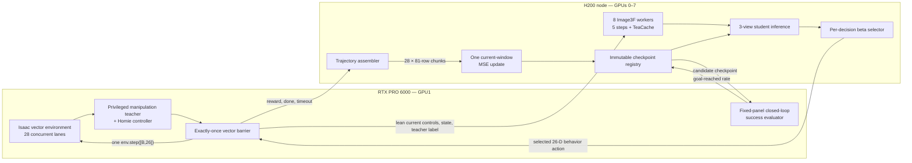

# RoboRender: distributed BC and real-time DAgger

This repository contains one source tree for the RoboRender project. It covers
teacher demonstration collection, offline photorealistic rendering, behavioral
cloning (BC), distributed online DAgger, and closed-loop success evaluation.

The live DAgger system is split across two machines:

- an RTX PRO 6000 owns Isaac, the privileged teacher, and the only call to
  `env.step`; and
- an eight-GPU H200 node owns Image3F, student inference, trajectory assembly,
  learning, checkpoint registration, and experiment telemetry.

Both machines must run the same Git commit. Host-local datasets, checkpoints,
renderer weights/engines, secrets, logs, and runtime journals are deliberately
outside Git and are bound by SHA-256 manifests.

## Current verified state

The lean v4 distributed path has completed a real B=28 smoke iteration:

- 81 synchronized vector steps and 2,268 real transitions;
- exactly 81 calls to `env.step([28, 26])`;
- 664/664 first-attempt cross-host RPC successes, with no retry, error, or OOM;
- one learner update from the 28 current-window chunks;
- training MSE `0.6420315584540845`, gradient norm
  `0.6199788451194763`, and immutable candidate checkpoint SHA-256
  `58b30db3a75d3885e2140008eaf36db43b0e4099d511bc55715ec5cc48f06559`.

The associated W&B run is
[`smoke-dagger-lean-v4-gpu1-b28-20260910T185659Z`](https://wandb.ai/nvidia/dagger/runs/smoke-dagger-lean-v4-gpu1-b28-20260910T185659Z).
This validates execution and observability; it is not a success-rate result or
a claim that DAgger has converged.

## End-to-end system



### One vector step

For every rollout index, all 28 environments move together:

1. RTX captures the current three-view Isaac controls and actor/critic state.
2. The privileged teacher produces the 11 manipulation dimensions; Homie
   supplies the deterministic 15-dimensional locomotion tail. The 26-D teacher
   action remains the target for every visited state.
3. RTX shards a lean v4 payload across eight independent H200 gateway ports.
4. For generated-control episodes, H200 renders three current RGB views with
   Image3F using the episode's fixed anchor. For ray-traced episodes, the
   already ray-traced three policy views bypass Image3F.
5. H200 runs the frozen student on the current three-view observation. A
   persisted Bernoulli draw selects teacher or student behavior according to
   the round beta.
6. Only after all 28 selections return does RTX execute exactly one
   `env.step([28,26])`.
7. Outcomes are committed to H200. In v4, the previous-step commit is pipelined
   with the next-step prepare; full learner rows remain in H200's per-window
   cache instead of being copied back to RTX.

The prepare/commit protocol is idempotent. A partial prepare cannot step Isaac,
and a lost acknowledgement cannot cause a second physical environment step.

### One learning iteration

One iteration is **not one episode**. It is an 81-row rollout window for each
of 28 lanes:

```text
81 sequential vector steps × 28 environments = 2,268 supervised transitions
                                         = 28 learner chunks
                                         = 1 optimizer update
```

A window may cross a real episode boundary. Per-row episode IDs, episode step
indices, `done`, and `timeout` preserve that fact. Only the current iteration's
chunks are trained; prior DAgger windows are not replayed.

### Four DAgger rounds

The teacher labels every state in every round. The beta changes only which
action moves Isaac:

| Round | Teacher behavior | Student behavior |
|---:|---:|---:|
| 1 | 75% | 25% |
| 2 | 50% | 50% |
| 3 | 25% | 75% |
| 4 | 0% | 100% |

The observation-source assignment is separate: 50% of episodes are ray-traced
and 50% use Image3F, sampled once per episode. Each round warm-starts from the
preceding selected checkpoint.

### Validation

Training MSE is optimization telemetry, not the promotion metric. At a
configured validation boundary (currently every 40 rollout/update iterations),
RTX runs the frozen candidate closed-loop on the same sealed 256-case panel.
Validation is inference-only and uses Raven's success definition:

```text
success = OR over infos["grasp_goal_reached"] during a completed episode
rate    = successful completed episodes / all completed episodes
```

The fixed panel is reused for fair checkpoint comparison. Final test is kept
separate. See `pipeline/evaluation/SUCCESS_RATE_EVALUATION_CERTIFICATION.md`.

## Offline BC flow

BC is a separate, offline pipeline:

1. `pipeline/bc_collection` runs Isaac with the privileged teacher and emits
   synchronized 81-row three-view condition/action chunks.
2. `pipeline/bc_rendering` uses the 50-step teacher LoRA to render each stored
   trajectory while preserving state and action arrays unchanged.
3. `pipeline/bc_training` trains the three-view visual student with MSE against
   the first 11 dimensions of the 26-D teacher action.
4. The selected BC checkpoint initializes DAgger round 1.

## Camera and renderer contracts

The policy always consumes vertically stacked views in this order:
`head_color`, `hand_left`, `hand_right`, each resized to 108×192.

Renderer slot semantics are stage-specific and must not be interchanged:

| Stage | `ext1` | `ext2` | `wrist` | RGB reference |
|---|---|---|---|---|
| 50-step offline teacher | `hand_left` | `hand_right` | `head_color` | none |
| 5-step online Image3F | `head_color` | `hand_left` | `hand_right` | fixed 3-view episode anchor |

Online controls are Raven `h5_v4` depth plus textured robot-on-black RGB at
240×416. The Image3F adapter is `rgb030-depth030-step-5000`; the H200 engine is
an SM90 build. Read `renderer/contracts/CONDITIONING_CONTRACT.md` before
changing preprocessing or view mappings.

## Repository layout

```text
roborender/
├── pipeline/
│   ├── bc_collection/       Isaac teacher-demonstration collection
│   ├── bc_rendering/        50-step offline teacher rendering
│   ├── bc_training/         three-view BC loader and learner
│   ├── dagger/
│   │   ├── services/        H200 control, render/student, learner services
│   │   ├── rtx/             RTX transition owner, vector barrier, validation
│   │   └── config/          portable experiment contracts
│   ├── evaluation/          success-rate semantics and certification
│   ├── vendor/              pinned Raven reference and bootstrap patches
│   └── tests/               H200/shared contract tests
├── renderer/                renderer contracts and local asset manifests
├── checkpoints/             model identity/provenance manifests
├── data/                    local canonical BC layout documentation
├── docs/                    repository-level manifests and design notes
├── skills/                  agent operating guidance
└── runtime/                 ignored host-local ledgers/logs/endpoints
```

`pipeline/GR00T-VisualSim2Real` is reconstructed locally at Raven commit
`94d79851d9c471b1210be81c75116d9bea835a4d` and remains ignored because it is
an external materialized dependency, not a second project repository.

## Services and ports

All endpoints bind to loopback and cross hosts only through authenticated SSH
forwarding.

| Host | Port(s) | Role |
|---|---:|---|
| H200 | 18500–18507 | eight loopback Image3F workers |
| H200 | 18610 | coordinator and iteration barriers |
| H200 | 18611 | authoritative trajectory publication |
| H200 | 18612 | content-addressed checkpoint registry |
| H200 | 18613 | fixed learner worker control |
| H200 | 18614 | fixed-panel evaluation ledger |
| H200 → RTX loopback | 18620–18627 | eight render/student data gateways |

The bearer token is a mode-0600 runtime secret and is never committed.

## Setup and verification

Bootstrap the pinned Raven dependency:

```bash
bash pipeline/bootstrap_raven_gr00t.sh
python pipeline/bc_collection/validate_raven_bc_collection_contract.py
python pipeline/dagger/validate_raven_image3f_contract.py
```

Run the shared H200 tests:

```bash
python -m pytest -q \
  pipeline/tests/test_dagger_h200_services.py \
  pipeline/tests/test_dagger_render_student_service.py \
  pipeline/tests/test_dagger_round_saturation.py \
  pipeline/tests/test_dagger_stream_v4.py \
  pipeline/tests/test_raven_success_validation.py \
  pipeline/tests/test_raven_dagger_eval_contract.py \
  pipeline/tests/test_raven_bc_collection_contract.py
```

Run the RTX component tests from either machine:

```bash
python -m pip install -e 'pipeline/dagger/rtx[test]'
python -m pytest -q pipeline/dagger/rtx/tests
bash -n pipeline/dagger/rtx/scripts/*.sh
```

Operational launchers are documented in `pipeline/dagger/README.md` and
`pipeline/dagger/rtx/README.md`. Never start a live run without matching
checkpoint, gateway, token, GPU-identity, and run-config attestations.

## Performance reference

For the verified lean-v4 B=28 smoke, a warm vector cycle averaged 4.852 s:

| Exclusive phase | Per vector step | Share |
|---|---:|---:|
| RTX capture + privileged teacher | 1.157 s | 23.9% |
| framing, transfer, Image3F/student, selection | 3.153 s | 65.0% |
| one RTX `env.step([28,26])` | 0.489 s | 10.1% |
| bookkeeping | 0.052 s | 1.0% |

The first cold prepare took 19.839 s. The full 81-step collection took about
seven minutes; core learning took 1.029 s and checkpoint writing 0.602 s.
These figures are an execution reference, not a guaranteed service-level
objective.

## Raven parity boundary

This repository is Raven-derived and contract-audited, but it must not be
described as a byte-for-byte reproduction of Raven's reported result:

- Raven's published 57.3% BC and 69.3% DAgger numbers came from a single-view
  policy; this project uses Raven's later three-view extension.
- Raven's recorded DAgger runs used teacher behavior throughout. The four-round
  25/50/75/100%-student schedule here is the requested canonical DAgger
  experiment.
- The split RTX/H200 v4 transport, B=28 capacity, SM90 engine, fixed 256-case
  validation panel, and telemetry are deployment/experimental extensions.
- The exact Raven goal latch, teacher labels, view/control preprocessing,
  Image3F settings, current-window learning, and no-replay semantics are kept
  and tested.

`pipeline/RAVEN_EQUIVALENCE_AUDIT.md` is the detailed source and parameter
crosswalk. Any new scientific deviation must be recorded there and in a
versioned config before it is used.

## Git and artifact policy

GitHub is the single source of truth for code. The H200 and RTX checkouts must
match by commit and clean source-tree hash; do not manually maintain divergent
copies. RTX is the intended push host because it has the working Git identity.

Never commit datasets, checkpoints, renderer weights, TensorRT engines,
containers, credentials, W&B state, or runtime journals. Register each
host-local artifact with its path, byte count, SHA-256, role, and provenance.
One immutable physical copy per host is preferred; compatibility symlinks are
allowed only where an upstream loader requires a fixed path.
