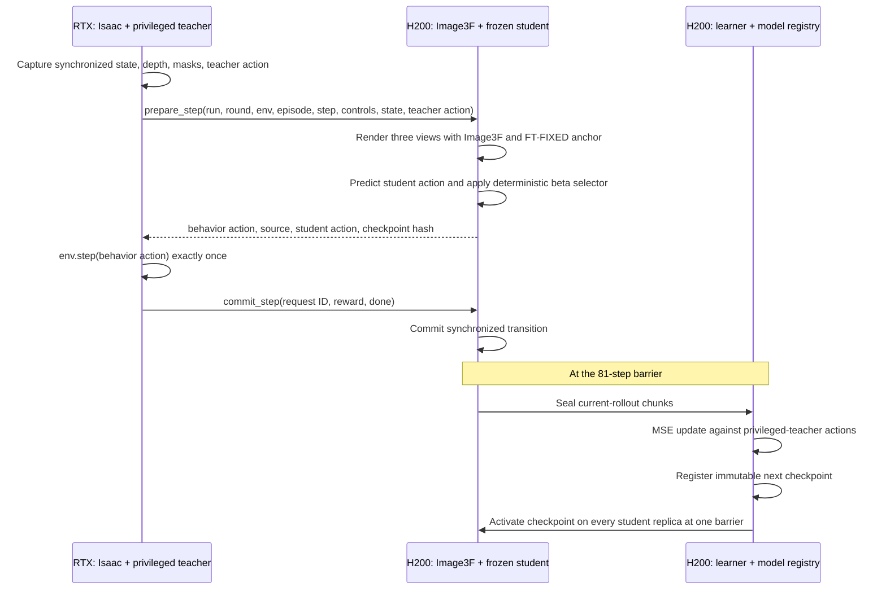

# Online Image3F DAgger

This stage uses the H200/path-portable form of Raven commit `94d7985`'s
three-view Image3F extension. The renderer, observation construction, teacher
labels, loss, and live-rollout update path are Raven's implementation. Our
four-round action schedule is the explicit canonical DAgger extension recorded
in `canonical_round_schedule.v1.json`.

Every policy step captures synchronized current depth and robot-only RGB for
`head_color`, `hand_left`, and `hand_right`. Image3F renders the three views
before the policy acts. One teacher-generated anchor triplet is sampled for
each environment episode and remains FT-FIXED until that episode resets.

## Distributed RTX–H200 execution

DAgger is a synchronous producer–consumer loop spanning two GPU roles. The RTX
actor exclusively owns Isaac and the irreversible environment transition. H200
owns Image3F rendering, student inference, trajectory storage, learning, and
checkpoint versioning. Student checkpoints remain on H200; only current-step
tensors and the selected action cross the network.

The two-phase step boundary is deliberate. `prepare_step` is idempotent and
may be retried because it returns the same cached action for the same request
identity. `env.step` is never retried by H200. A transition becomes eligible
for training only after the RTX actor acknowledges it through `commit_step`.
An incomplete episode or uncommitted transition is never admitted to the
learner.

The production placement is:

| Hardware | Services |
| --- | --- |
| RTX GPU | Isaac actor and privileged robot teacher |
| H200 GPUs 0–6 | Warm Image3F plus frozen student-inference replicas |
| H200 GPU 7 | Learner, coordinator, trajectory ledger, model registry |

For an Image3F step, RTX sends the three current depth controls, robot masks,
actor state, teacher label, anchor identity, and transaction identity. H200
stores the generated observation locally and returns only the selected action
and provenance. For an episode assigned to Raven's ray-traced half of the mix,
RTX sends the three policy RGB views instead of requesting Image3F generation.

The H200 coordinator, trajectory, registry, and learner service boundaries are
implemented in `services/`. The RTX `prepare_step`/`commit_step` actor adapter
and the direct authenticated RTX–H200 transport are the remaining integration
boundary; this diagram describes the target production deployment, not a claim
that the cross-host rollout has already run.

The shared Raven settings are fixed:

- the teacher labels every visited state;
- 50% of environment episodes retain ray-traced observations and 50% use
  Image3F observations;
- seed 42, anchor index 0, h5_v4 depth, 240x416 renderer controls;
- Image3F five steps, CFG 1, TeaCache 0.3, untiled VAE;
- 81 live steps followed by one update with one minibatch;
- only the current live rollout is trained—there is no replay buffer;
- each round restores the preceding checkpoint's model, optimizer, scheduler,
  environment, and trainer state, then runs an additional round budget.

The action schedule is sampled independently for every environment decision:

| Round | Teacher beta | Student decisions |
| --- | ---: | ---: |
| DAgger 1 | 0.75 | 25% |
| DAgger 2 | 0.50 | 50% |
| DAgger 3 | 0.25 | 75% |
| DAgger 4 | 0.00 | 100% |

At every step Image3F first replaces the current visual observation. Both the
student and privileged teacher then act on that same current Isaac state. The
Bernoulli selector chooses the behavior action, and the base trainer passes
that exact tensor to `env.step`. The teacher action remains the supervised MSE
target regardless of which action moved the environment.

The inherited legacy `enforce_teacher_rollout` path is explicitly disabled.
Leaving it enabled would silently force the first half of the environments to
teacher actions before the canonical beta selector and would corrupt the
requested mixture.

Raven's trainer, PPO base, client, and Hydra config live in
`../GR00T-VisualSim2Real` at `94d7985`. The reference result used beta 1.0 for
every reported round; `raven_image3f_dagger_contract.v1.json` preserves that
historical fact. The active launcher overrides only action selection to the
canonical schedule above and disables the older overlapping teacher override.

`run_raven_dagger_round_h200.sh` and `run_raven_four_rounds_h200.sh` preserve
the original monolithic Raven execution path for bounded component testing.
They are not the production cross-host launcher because they instantiate Isaac
inside the H200 process. Production execution uses `services/` after the RTX
actor adapter is connected; round 1 starts from the selected three-view BC
checkpoint and each subsequent round starts from the preceding promoted
checkpoint.

`pipeline/round_dagger/` is the superseded custom persisted-shard/replay
framework. It is not imported or invoked by this live Raven/Image3F path and
must not be combined with it. DAgger training here uses only the current live
81-step rollout, matching Raven's trainer.

`services/` contains the network boundaries for splitting that same live loop
across RTX actors and H200 infrastructure. The coordinator, trajectory store,
checkpoint registry, and learner job controller are separate server roles;
they share a transactional metadata ledger but do not duplicate Image3F or
Isaac code. `run_h200_service.sh` launches one role per process/container.
Service extraction changes deployment topology only: the 81-step current-
rollout update, three-view observation contract, teacher labels, and canonical
beta schedule remain unchanged.

The online slot mapping is specifically `ext1=head_color`,
`ext2=hand_left`, `wrist=hand_right`. It must not be replaced by the offline
teacher's left/right/head request order.
